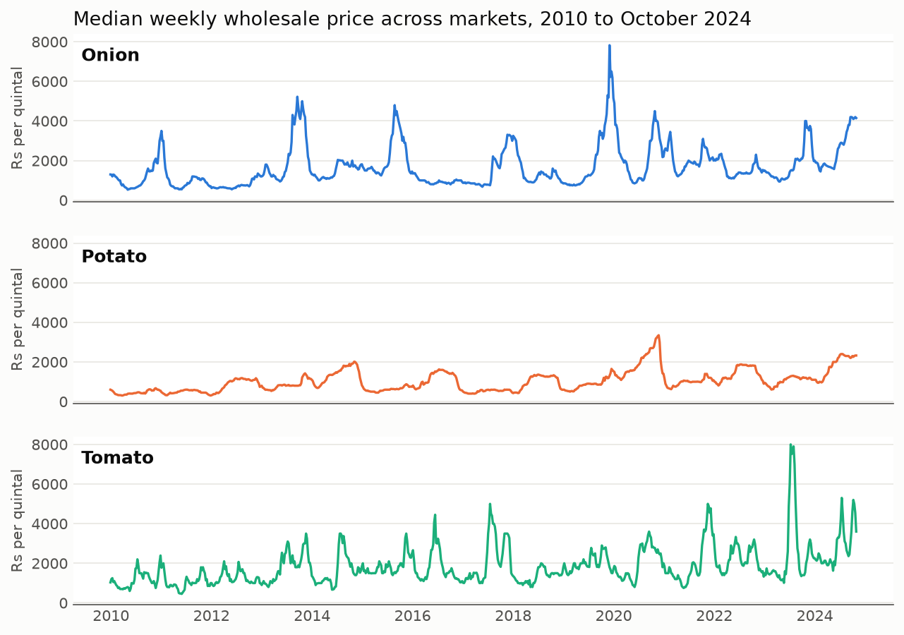
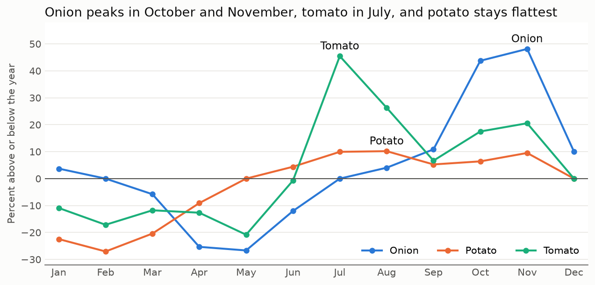

# Mandi Crop Price Forecasting

Forecast wholesale onion, tomato and potato prices across Indian mandis, and warn early when a price spike is likely. These three crops swing sharply in price, which hits farmers and households alike.

> Status: data collected, cleaned and explored, with models tested, forecast ranges added, spike alerts tested and the final test run (steps 1 to 8 done). Results get filled in as the work is done.

## Data

Daily minimum, maximum and modal (most common) wholesale prices by market, from the [Variety-wise Daily Market Prices Data of Commodity](https://www.data.gov.in/resource/variety-wise-daily-market-prices-data-commodity) dataset on data.gov.in. It is published by the Directorate of Marketing and Inspection from [Agmarknet](https://agmarknet.gov.in), under the Open Government License India.

Collected so far: the 20 busiest districts for each crop in 2024, with their full histories, plus three districts that were later renamed or split.

| Crop | Rows | First record | Last record | Markets (as spelled in the data) |
| --- | --- | --- | --- | --- |
| Onion | 561,407 | 2001-03-30 | 2026-10-31 | 420+ |
| Potato | 518,068 | 2001-03-30 | 2026-10-31 | 318 |
| Tomato | 483,455 | 2002-01-09 | 2026-10-31 | 357+ |

Records are thin before about 2007 and fuller from 2010. This dataset has prices only, with no arrival quantities.

**To get it:** create a free key on data.gov.in and put `DATA_GOV_IN_API_KEY=your_key` in a `.env` file, which stays out of git. Then run `python -m src.collect --rank` and `python -m src.collect`. The data stays out of git too.

**What cleaning found:**
- Market names changed when Agmarknet 2.0 launched in November 2025, and districts such as Ahmednagar (now Ahilyanagar) were renamed or split. These are joined back into one series.
- Real price spikes survive the cleaning, including tomato in 2023 and onion in 2019.
- Kerala has no records for any crop at the source since June 2026, so its markets stay useful for backtests but can't have live forecasts. `data/processed/markets.parquet` marks which markets are reporting now.

Agmarknet data should be credited as the source wherever it's used. Weather and arrivals are optional later additions.

## Plan

1. **Collect.** The busiest 20 districts for each of the three crops, with the source and date of each download recorded in `data/raw/manifest.json`.
2. **Clean.** Run `python -m src.clean`. Removes duplicates and impossible prices, joins market names across renames, and builds one weekly price per crop and market from 2010. See the [cleaning report](reports/cleaning_report.md).
3. **Explore.** Seasonality, harvest cycles, how a price move in one mandi spreads to others, and how storable crops differ from perishable ones. Run `python -m src.explore`, which uses weeks before November 2024 only. See the [exploration report](reports/exploration.md).
4. **Baselines first.** "Next week equals this week" and "same week last year". Every model must beat these. Run `python -m src.backtest`. See the [baseline report](reports/baselines.md).
5. **Models.** Exponential smoothing, then one LightGBM model per crop and horizon across all markets, using past prices, price moves elsewhere and calendar features, retrained before each validation year. Run `python -m src.models`. See the [model report](reports/models.md).
6. **Validate.** Rolling-origin backtests, never random splits, with error against the baselines at 1, 2 and 4 weeks ahead. Run `python -m src.validate`. See the [validation report](reports/validation.md).
7. **Uncertainty.** 80% forecast ranges from quantile models, corrected using the previous year's misses, and checked for how often the real price falls inside them. Run `python -m src.intervals`. See the [ranges report](reports/intervals.md).
8. **Spike alerts.** A spike is a price at least twice the market's median over the previous 52 weeks. The alerts warn of a new spike at a market within four weeks, and are measured on how many spikes were flagged in advance and how many alerts were false, against a rule of thumb and the calendar. Run `python -m src.alerts`. See the [alerts report](reports/alerts.md).
9. **App.** A Streamlit page: pick a crop and market to see history, the forecast range and any spike warning.

## What the data shows

Up to October 2024, a typical four-week move was about 12% for potato, 20% for onion and 32% for tomato, so the more perishable the crop, the harder it swings. The final two years stay untouched for testing.





## Project layout

```
data/raw/          Downloads from Agmarknet sources (not in git)
data/processed/    Cleaned tables (not in git)
notebooks/         Exploration and experiments, numbered in order
src/               Reusable code: collection, cleaning, features, backtesting
models/            Saved models (not in git)
app/               Streamlit app
reports/figures/   Charts for the README
```

## Setup

```bash
python -m venv .venv
.venv\Scripts\activate
pip install -r requirements.txt
```

## Results

Scored once on November 2024 to October 2026, a period kept out of all earlier work. Models were retrained before each test year, with settings fixed in advance. Errors are mean absolute percent error, and lower is better. "Gain" is the error reduction against "next week equals this week", with a 95% range from resampling weeks.

| Crop | Weeks ahead | This week | LightGBM | Gain | Gain range | 80% range held |
| --- | --- | --- | --- | --- | --- | --- |
| Onion | 1 | 10.35% | 10.07% | 2.6% | 0.4 to 4.9 | 78.2% |
| Onion | 4 | 21.41% | 19.91% | 7.0% | -0.1 to 13.2 | 78.2% |
| Potato | 1 | 5.59% | 5.40% | 3.4% | 0.8 to 5.8 | 81.5% |
| Potato | 4 | 14.07% | 12.95% | 8.0% | -0.9 to 15.4 | 77.2% |
| Tomato | 1 | 13.87% | 13.42% | 3.2% | 0.5 to 6.0 | 81.9% |
| Tomato | 4 | 31.23% | 27.13% | 13.1% | 5.9 to 19.5 | 83.5% |

**Spike alerts** warned of 79% of onion spikes and 85% of tomato spikes in advance. 46% of onion alerts and 17% of tomato alerts came true. Potato had only one spike in the period, so its alerts can't be judged. Full tables are in the [final test report](reports/final_test.md).

Gains are smaller than on validation years, and the onion and potato four-week ranges include zero. The market list was chosen using which markets were still reporting in 2026, so these markets are slightly favoured.
